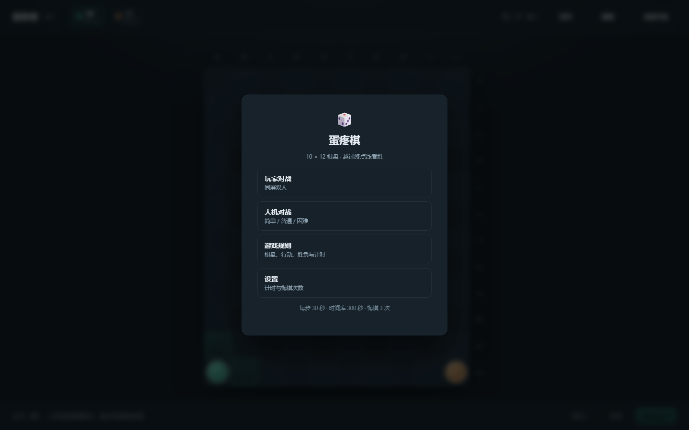
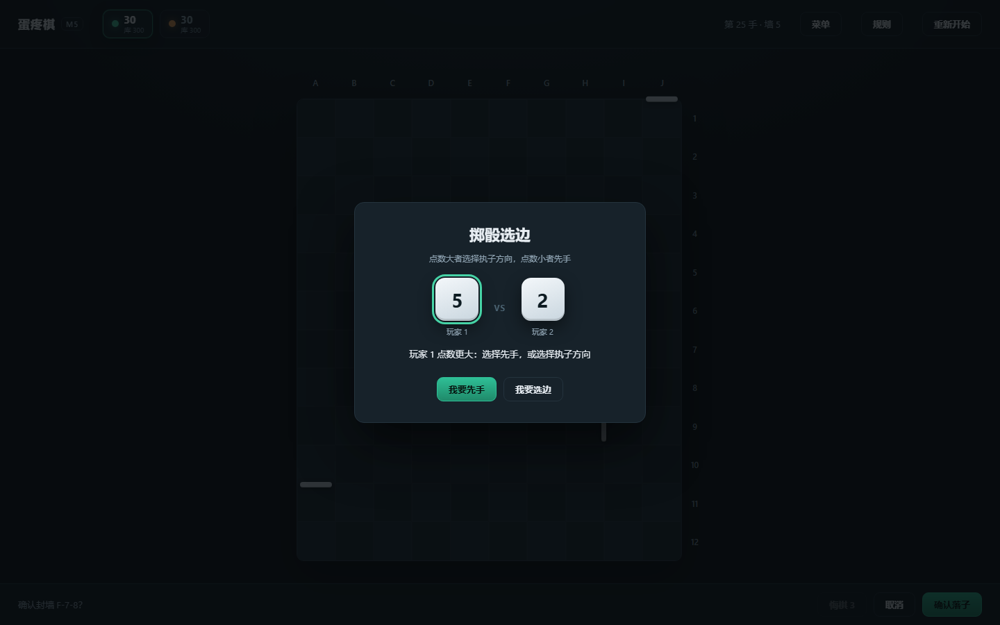

# 蛋疼棋

10 × 12 的两人棋：先越过终点线者胜。但若你到达时，对手下一手也能到达，就判平局——
所以光跑没用，得靠封墙拉开差距。

## 直接玩

1. 打开 [`dist/蛋疼棋.html`](dist/蛋疼棋.html)，点右上角 **Download** 下载；
2. 双击，用浏览器打开（无需安装、无需联网）；
3. 主菜单选「玩家对战」或「人机对战」。



## 怎么玩

- 每回合二选一：**上下左右走一格**，或在格线上**封一面墙**；
- 墙对双方都阻挡，但不能把任何一方完全封死；
- 两枚棋子可以站在同一格；
- 走到第 1 行、并从上方没有墙的列越出，即为到达；
- 到达时对手也一步可到 → **平局**（这是核心平衡设计，不是 bug）；
- 每步 30 秒，另有 300 秒时间库；超时由系统自动代走；
- 每方 3 次悔棋，需对方同意。



## 开发

纯逻辑实现，不依赖任何第三方包，Node ≥ 20 即可运行。界面是原生 ES Module，无构建步骤。

## 目录

```
index.html / styles.css / app.js   界面（原生 ES Module，无构建步骤）
src/
  config.js     对局参数（每步 30 秒、时间库 300 秒、悔棋 3 次）
  board.js      棋盘常量、228 个墙位的坐标编码与命名
  path.js       BFS 最短路（到终点线的步数、路径上的可封墙位）
  rules.js      状态、合法行动、封墙校验、到达/平局判定、超时代走选步
  clock.js      每步计时 + 时间库的推进逻辑
  ai.js         简单 / 普通 / 困难三档 AI
  selfplay.js   自动对局与批量统计
test/
  engine.test.js  16 项规则单测
  clock.test.js   10 项计时与自动选步单测
tools/
  serve.js        本地预览服务器
  ui-check.mjs    界面自检（CDP 真实鼠标事件）
  build-single.mjs 打包成单文件 HTML
  balance.js      自对弈平衡测试 CLI
dist/
  蛋疼棋.html     打包产物，双击即玩
docs/
  蛋疼棋_规则说明书_v1.2.docx   规则唯一事实来源
  蛋疼棋_需求总表_v1.1.docx
  蛋疼棋_平衡测试报告_v1.0.docx
  archive/        早期版本
  素材/           原始需求文档、玩法 PDF、2022 年 Demo
```

## 打包（发给朋友体验）

```bash
node tools/build-single.mjs      # → dist/蛋疼棋.html
```

把 CSS 与全部脚本内联成一个单文件（约 70 KB，零外部依赖），**双击用浏览器打开即可，不需要服务器**。
打包产物同样跑过完整的 57 项界面自检：

```bash
node tools/ui-check.mjs --file "dist/蛋疼棋.html"
```

## 命令

```bash
node --test                                   # 跑单测
node tools/balance.js                         # 默认：容差 0/1/2，各 400 局
node tools/balance.js --games 500 --ai greedy --tolerance 1
node tools/balance.js --games 500 --ai greedy --tolerance 1 --wallLimit 20
node tools/balance.js --games 300 --ai "greedy,greedy-move" --tolerance 1

node tools/serve.js 5173                      # 启动界面 http://127.0.0.1:5173
node tools/ui-check.mjs                       # 界面交互自检（需要先起 serve）
```

## 界面（M2）

`index.html` + `styles.css` + `app.js`，原生 ES Module，直接 `import` 内核，无构建步骤。

- 10×12 棋盘、A–J / 1–12 坐标、228 个墙位；
- 点击格子 → 预览 → 确认落子（也可再点一次同一目标直接确认）；
- 点击格线 → 预览封墙；封死通路时红墙 + 顶部提示，不弹窗；
- 同格用斜向错开显示；站在第 1 行时列标签上方出现 ▲ 提示可越线；
- 结算页区分胜/负/平局，平局会说明原因。

### 计时与悔棋（M3）

- 每步 30 秒，用尽后从本人 300 秒时间库扣除；库空后每步仍 30 秒（`src/config.js` 可改）；
- 时间耗尽由系统代走（BFS 最短路，同长优先向上），顶部提示“超时，系统代走”；
- 顶栏两个计时块：大数字为本步剩余（未轮到时显示 30），下方为时间库余额；
- 悔棋默认每人 3 次，点击后弹出页面内确认框，由对方选择同意/拒绝；
  撤销的是**最近一手**，棋子、墙、计时、时间库一并回滚；
- 结算页或页面切到后台时暂停计时。

调试参数：`?demo=1`（中盘）、`?demo=same`（同格）、`?demo=win`、`?demo=draw`、`?demo=undo`、
`?demo=rules`、`?demo=settings`、`?demo=home`。

`tools/ui-check.mjs` 通过 CDP 发送**真实鼠标事件**（`Input.dispatchMouseEvent`）并校验 43 条断言，其中包含 `elementFromPoint` 命中检测——用来防止“图层挡住点击”这类问题被 `element.click()` 掩盖。

### 入口、规则与设置（M5）

- 主菜单：玩家对战 / 人机对战（二级难度）/ 游戏规则 / 设置；
- 开局掷骰：点数大者在「先手」和「选边」中二选一，另一项归点数小者；人机模式下电脑自己选；
- 对局中顶栏「规则」可随时查看，打开时自动暂停计时；「菜单」返回主菜单；
- 设置页可改每步时间、时间库、悔棋次数，写入 `localStorage`，下一局生效；
- 结算页提供「再来一局 / 返回主菜单」。

### 人机三档（M4）

| 档位 | 策略 | 对下一位的胜率 |
|---|---|---|
| 简单 | 25% 随机 + 75% 贪心 | 对普通约 4% |
| 普通 | 贪心（对手最短路 − 自己最短路） | — |
| 困难 | 贪心候选 + 预判对手最佳应手 | 对普通约 87% |

自对弈命令：`node tools/balance.js --games 150 --ai "hard,normal" --tolerance 1`。

参数：

| 参数 | 说明 |
|---|---|
| `--games` | 每种配置的对局数 |
| `--ai` | `random` / `greedy` / `greedy-move`；逗号分隔可指定双方不同 AI |
| `--tolerance` | 平局容差：0 = 先到即胜，1 = 对手一步可到则平局（规则书默认） |
| `--wallLimit` | 每人墙上限；`20` 表示双方各 20，`20,22` 表示先手 20、后手 22 |
| `--seed` | 随机种子，保证结果可复现 |

## 规则要点

以 docs/蛋疼棋_规则说明书_v1.2.docx 为准。内核中的关键约定：

- 坐标：列 A–J（0–9），行 1–12（0–11），`r=0` 是靠近终点线的一行。
- 到达：位于 `r=0` 且该列上端无墙，再向上越出棋盘。
- 平局：一方到达时，若对手到终点的最短路 ≤ `tolerance`，判平局（默认 1 手）。
- 封墙：任何墙位落下后，双方都必须仍存在到终点的路径，否则拒绝。
- 墙位 228 个 = 竖墙 108 + 横墙 110 + 上端 10。

## 后续

- M2：棋盘渲染与交互（本地同屏）
- M3：计时、悔棋、结算
- M4：人机三档（在 `ai.js` 上扩展）
