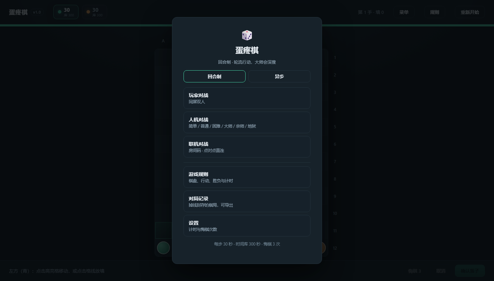

# 蛋疼棋

10 × 12 的两人棋：先越过终点线者胜。但**如果你到达时，对手下一手也能到达，就判平局**——
所以光跑没用，必须用墙把对手拖慢两步以上。这也是它“蛋疼”的地方。



## 直接玩

1. 下载 [`dist/蛋疼棋.html`](dist/蛋疼棋.html)（页面右上角 **Download**）；
2. 双击，用任意现代浏览器打开——**无需安装、无需联网**；
3. 单人可打人机，两个人可以同屏，联网可以开房间。

> 单文件版是构建产物，源码改动后用 `node tools/build-single.mjs` 重新生成。

## 玩法速览

- 每回合二选一：**上下左右走一格**，或在格线上**封一面墙**；
- 墙对双方都阻挡，但不能把任何一方完全封死；
- 两枚棋子可以站在同一格；
- 走到第 1 行、并从上方无墙的列越出，即为到达；
- **到达判定**：先手到达时，若后手也一步可到，判平局；后手到达时，即使先手一步可到，也判后手胜
  （先手必须领先两手才算赢，后手领先一手即可）；
- 每步 30 秒，另有 300 秒时间库，超时由系统自动代走；
- 每方 3 次悔棋（需对方同意），任何模式都可以认输。

## 三种模式

| 模式 | 说明 |
|---|---|
| 玩家对战 | 同屏双人，轮流操作 |
| 人机对战 | 简单 / 普通 / 困难 / 大师 / 地狱 |
| 联机对战 | 房间码直连，无需服务器；连不上可用「连接码」兜底 |

### 联机怎么用

联机需要一台能跑 Node 的服务器（自带一个进程同时提供页面和 WebSocket，无需反向代理）。

1. 主菜单 →「联机对战」→「创建房间」，拿到 6 位房间码；
2. 对方「联机对战」→「加入房间」，输入房间码；
3. 双方进入掷骰，**大点者在「先手 / 选边」中二选一**，另一项归对方。

部署方式见 [deploy/README.md](deploy/README.md)，一条命令：

`ash
sudo bash deploy/install.sh
`

对局中支持：悔棋（请求-同意，30 秒超时）、认输、再来一局、掉线自动重连（90 秒判负）。
所有判定都在服务端完成，客户端只负责渲染。

### 存档

联机的棋局掉线时可以选择封存，最多 **3 个**存档位，保存时命名（默认精确到秒）。
主菜单「对局记录」里可以查看、**导出 JSON**、删除。

## 目录结构

```
index.html / styles.css / app.js   界面（原生 ES Module，无构建步骤）
src/
  config.js     对局参数（30 秒 / 300 秒 / 悔棋 3 次）
  board.js      棋盘常量、228 个墙位的坐标编码
  path.js       BFS 最短路与路径上的可封墙位
  rules.js      状态、合法行动、封墙校验、到达/平局、超时代走
  clock.js      计时与时间库
  ai.js         四档 AI（贪心 / 平局感知 / 迭代加深搜索 / 大师注册表）
  ai-master.js  大师 AI：迭代加深 + 结构评估 + 锁路计划层
  ai-random.js  随机与随机数工具（被两套 AI 共用）
  selfplay.js   自动对局与统计
  storage.js    本地存档位
  net/          联机：WebSocket 客户端（ws-client.js）
test/           单测（引擎、计时、协议、会话、存储）
tools/          预览服务、界面自检、打包、平衡测试
server/         联机服务端（Node + ws，复用 src/rules.js）
deploy/         一键安装脚本与部署说明
dist/           打包产物
docs/           规则、需求、平衡报告与截图
```

## 开发

```bash
node --test                                   # 单测
node tools/serve.js 5173                      # 本地预览 http://127.0.0.1:5173
node tools/ui-check.mjs                       # 界面自检（真实鼠标事件）
node tools/net-ui-check.mjs                   # 联机端到端（两个浏览器互连）
node tools/net-check.mjs                      # WebRTC 连接码连通性
node tools/build-single.mjs                   # 打包成单文件
node tools/balance.js --games 12 --ai "hard,normal"   # 自对弈
```

## 测试与数据

| 项 | 结果 |
|---|---|
| 引擎/计时/协议/会话/存储/异步引擎单测 | 69 项全通过 |
| 界面自检（含打包产物） | 60 项全通过 |
| 服务端单测 | 16 项全通过 |
| 联机端到端（真实服务端 + 两浏览器） | 14 项全通过 |
| 难度阶梯自检 | 
ode tools/ladder-check.mjs，高档必须稳定赢过低档 |

> 平衡数据请在改动规则后重跑 	ools/ladder-check.mjs，它按生产预算比例缩放搜索时间。

AI 强度：

| 档位 | 策略 | 思考预算 |
|---|---|---|
| 简单 | 25% 随机 + 贪心 | 即时 |
| 普通 | 贪心 + 平局规则感知 | 即时 |
| 困难 | 四层迭代加深 + 结构评估 | 350ms |
| 大师 | 六层迭代加深 + 结构评估（v2）+ 锁路计划层 | 1200ms |
| 地狱 | 二十层迭代加深 + 结构评估（v2）+ 锁路计划层 | 用满每步时限（默认 28s） |

> 困难/大师/地狱三档在 Web Worker 中计算，思考期间界面不卡、计时正常走；
> 单文件版会把 Worker 源码内联成 Blob，dev 版直接加载 src/ai-worker.js；
> 因为太慢，	ools/ladder-check.mjs 不包含它。

难度阶梯自检（
ode tools/ladder-check.mjs）让每档都对「简单」跑若干局（交替先后手），
要求胜率随档位单调上升且达到下限，否则返回非零退出码。

> 之所以固定弱基准而不是两两对拍：这游戏先手优势很大，两两对拍时座位效应会盖过实力差，
> 小样本几乎总是 50%，分不出高下。

## 文档

| 文件 | 状态 |
|---|---|
| [规则说明书 v1.3](docs/蛋疼棋_规则说明书_v1.3.docx) | **当前版本**，规则唯一事实来源 |
| [需求总表 v1.1](docs/蛋疼棋_需求总表_v1.1.docx) | 规划版（联机功能早于本表） |
| [平衡测试报告 v1.0](docs/蛋疼棋_平衡测试报告_v1.0.docx) | 历史数据，规则未变仍可参考 |
| [联机服务器设计 v1.0](docs/蛋疼棋_联机服务器设计_v1.0.md) | 协议、房间状态机、部署与测试计划 |
| `docs/archive/` | 早期版本，仅存档 |
| `docs/素材/` | 原始需求文档、玩法 PDF、2022 年 Demo |

## 已知限制

- **联机需要自建服务器**（部署见 deploy/README.md），没有官方公共服；
- 服务端房间只存内存，重启会丢进行中的对局；
- 封存的存档目前**只能回放/导出，不能续下**（续局是后续迭代）；
- 手机可用但未针对触屏优化（封墙依赖悬停预览）。
